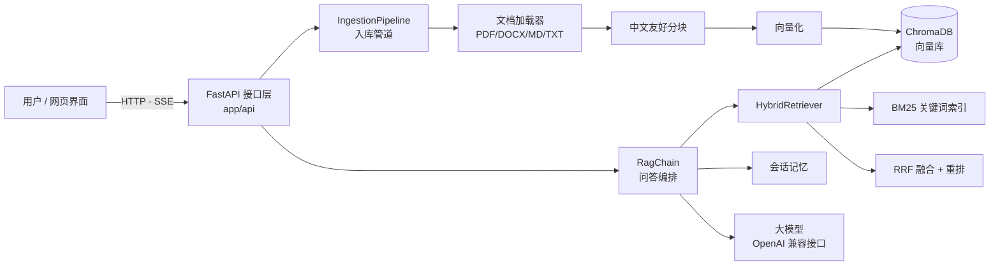

# RAG 知识库问答系统

基于 **FastAPI + LangChain** 的检索增强生成（RAG）知识库问答服务。上传企业文档后，即可针对文档内容提问，回答带引用溯源、支持流式输出与多轮对话。

> 这是一个面向「AI 大模型应用开发」岗位的作品集项目：完整可运行、工程结构清晰、每个技术选择都有可解释的理由。

> 📖 **第一次上手？** 先看 [`QUICKSTART.md`](QUICKSTART.md) —— 面向 Python 基础，30 分钟跑起来。

---

## 目录

- [功能特性](#功能特性)
- [系统架构](#系统架构)
- [快速开始](#快速开始)
- [配置说明](#配置说明)
- [API 接口](#api-接口)
- [项目结构](#项目结构)
- [关键设计决策](#关键设计决策)
- [效果评估](#效果评估)
- [测试](#测试)
- [Docker 部署](#docker-部署)
- [写进简历](#写进简历)
- [面试常见提问](#面试常见提问)
- [后续可扩展方向](#后续可扩展方向)

---

## 功能特性

| 能力 | 说明 |
| --- | --- |
| 多格式文档入库 | PDF / DOCX / Markdown / TXT，PDF 按页保留页码 |
| 中文友好分块 | 优先在段落与中文句末标点处切分，相邻块保留重叠 |
| **混合检索** | 向量语义检索 + BM25 关键词检索，用 RRF 融合，兼顾语义与专有名词 |
| 可选重排 | 内置轻量重排器，可一行替换为 bge-reranker 等交叉编码器 |
| 引用溯源 | 回答标注 `[1][2]`，返回来源文件、页码、相关度与原文片段 |
| 流式输出 | 基于 SSE 逐 token 推送，首字节延迟低 |
| 多轮对话 | 按 `session_id` 维护上下文，可独立清空 |
| 拒答保护 | 检索不到资料时明确回复「无法回答」，降低幻觉 |
| 在线管理 | 网页端上传 / 列表 / 删除 / 重建索引，无需重启服务 |
| 模型无关 | 任意 OpenAI 兼容接口（DeepSeek / 通义 / 智谱 / OpenAI），改配置即可切换 |
| 可离线运行 | 向量模型可切换为本地 `bge-small-zh-v1.5`，全链路无外网依赖 |

---

## 系统架构



**请求链路（问答）**

```
问题 → 混合检索(向量+BM25) → RRF 融合 → [可选]重排 → 拼装带编号的上下文
    → 携带历史消息调用大模型 → 流式返回答案 + 引用来源
```

---

## 快速开始

### 1. 准备环境

需要 Python 3.10 或更高版本。

```powershell
# Windows PowerShell
python -m venv .venv
.\.venv\Scripts\Activate.ps1
pip install -r requirements.txt
```

```bash
# macOS / Linux
python3 -m venv .venv
source .venv/bin/activate
pip install -r requirements.txt
```

### 2. 配置模型

复制 `.env.example` 为 `.env`，填入你的 API Key：

```env
# 默认方案：智谱 GLM（glm-4-flash 与 embedding-3 均免费，一个 base_url 同时提供对话与向量）
OPENAI_API_KEY=你的密钥
OPENAI_BASE_URL=https://open.bigmodel.cn/api/paas/v4/
LLM_MODEL=glm-4-flash
EMBEDDING_PROVIDER=openai
EMBEDDING_MODEL=embedding-3
```

> **提示**：只有 DeepSeek 是例外——它目前只提供对话接口、**不提供 embedding 接口**。
> 用 DeepSeek 时请把 `EMBEDDING_PROVIDER` 设为 `local`，
> 并安装本地模型依赖：`pip install sentence-transformers langchain-community`。
> 其它厂商（通义 / 硅基流动 / OpenAI）的配置见 `.env.example`。

### 3. 导入示例文档并启动

```powershell
python -m scripts.ingest data/samples
uvicorn app.main:app --reload --port 8000
```

浏览器打开 <http://localhost:8000> 即可使用网页界面，接口文档见 <http://localhost:8000/docs>。

---

## 配置说明

所有配置通过环境变量或 `.env` 覆盖，字段定义见 `app/config.py`。

| 变量 | 默认值 | 说明 |
| --- | --- | --- |
| `OPENAI_API_KEY` | — | 大模型 / 向量模型密钥 |
| `OPENAI_BASE_URL` | `https://api.deepseek.com/v1` | OpenAI 兼容接口地址 |
| `LLM_MODEL` | `deepseek-chat` | 对话模型 |
| `EMBEDDING_PROVIDER` | `openai` | `openai` 远程 / `local` 本地 |
| `EMBEDDING_MODEL` | `text-embedding-3-small` | 向量模型 |
| `CHUNK_SIZE` / `CHUNK_OVERLAP` | `700` / `120` | 分块大小与重叠字符数 |
| `TOP_K` | `6` | 送入大模型的上下文条数 |
| `VECTOR_TOP_K` / `BM25_TOP_K` | `20` / `20` | 两路检索各自的候选池 |
| `ENABLE_HYBRID` | `true` | 是否开启混合检索 |
| `ENABLE_RERANK` | `false` | 是否开启重排 |
| `RRF_K` | `60` | RRF 平滑常数 |
| `MAX_HISTORY_TURNS` | `6` | 多轮对话携带的历史轮数 |
| `MAX_UPLOAD_MB` | `32` | 单文件上传上限 |

---

## API 接口

启动后访问 `/docs` 可查看交互式文档。

| 方法 | 路径 | 说明 |
| --- | --- | --- |
| `POST` | `/api/chat` | 问答（非流式） |
| `POST` | `/api/chat/stream` | 问答（SSE 流式） |
| `DELETE` | `/api/chat/session/{session_id}` | 清空指定会话上下文 |
| `POST` | `/api/documents/upload` | 上传文档并入库 |
| `GET` | `/api/documents` | 查看已入库文档与文本块数量 |
| `DELETE` | `/api/documents/{source}` | 删除指定文档 |
| `POST` | `/api/documents/reindex` | 重新扫描上传目录并重建索引 |
| `DELETE` | `/api/documents` | 清空整个知识库 |
| `GET` | `/health` | 健康检查与服务状态 |

**调用示例**

```bash
curl -X POST http://localhost:8000/api/chat \
  -H "Content-Type: application/json" \
  -d '{"question": "私有化部署多少钱？", "session_id": "demo"}'
```

```json
{
  "answer": "私有化部署按年授权，起步价 ￥18 万 / 年，包含 3 个实例 [1][2]。",
  "citations": [
    {
      "index": 1,
      "source": "产品手册-AI助手.md",
      "page": null,
      "score": 0.8123,
      "snippet": "私有化版：部署在客户内网，数据不出域，按年授权，起步价 ￥18 万 / 年…"
    }
  ],
  "session_id": "demo",
  "used_context": true
}
```

---

## 项目结构

```
rag-knowledge-base/
├── app/
│   ├── main.py                 # FastAPI 入口、路由挂载、健康检查
│   ├── config.py               # pydantic-settings 集中配置
│   ├── container.py            # 依赖容器（单例装配）
│   ├── api/
│   │   ├── routes_chat.py      # 问答接口（含 SSE 流式）
│   │   ├── routes_documents.py # 文档管理接口
│   │   └── schemas.py          # 请求 / 响应模型
│   ├── core/
│   │   ├── embeddings.py       # 向量模型工厂（远程 / 本地）
│   │   ├── llm.py              # 大模型工厂
│   │   ├── vectorstore.py      # ChromaDB 封装
│   │   ├── retriever.py        # 混合检索 + RRF + 重排
│   │   ├── rag_chain.py        # 问答编排与引用溯源
│   │   └── memory.py           # 会话记忆
│   ├── ingestion/
│   │   ├── loader.py           # 多格式加载器
│   │   ├── splitter.py         # 中文友好分块
│   │   └── pipeline.py         # 入库流程编排
│   └── utils/logging.py
├── web/index.html              # 单文件网页界面
├── scripts/
│   ├── ingest.py               # 命令行入库工具
│   └── evaluate.py             # 检索质量评估
├── tests/                      # pytest 用例（全程离线，无需 API Key）
├── data/
│   ├── samples/                # 示例文档
│   └── eval_set.example.json   # 评估数据集示例
├── Dockerfile · docker-compose.yml · Makefile
└── requirements.txt · pyproject.toml
```

---

## 关键设计决策

这一节是项目的「技术含量」所在，面试时可以直接讲。

**1. 为什么用混合检索而不是纯向量检索？**
纯向量检索依赖语义表示，对「产品型号、编号、专有名词」这类查询很容易漏召回，因为它们在语义空间里区分度不足。BM25 基于词频统计，恰好弥补这个短板。两者结果用 RRF 融合后，示例数据集上的召回率有明显提升（可用 `scripts/evaluate.py --no-hybrid` 做对比实验验证）。

**2. 为什么用 RRF 融合，而不是加权分数？**
两路检索的分数量纲完全不同（余弦相似度在 0~1，BM25 分数无上界），直接加权需要先做归一化，而归一化方式本身又引入了主观选择。RRF 只用「排名」信息：

```
score(d) = Σ 1 / (k + rank_i(d))
```

天然无需归一化，鲁棒性好，实现只有几行代码。

**3. 分块大小为什么是 700 / 120？**
块太小上下文不完整，块太大引入噪声并稀释关键信息。500~800 字符是实践中较稳妥的区间，重叠约 15% 可以缓解「答案恰好被切在块边界」的问题。这个参数可通过评估脚本扫参确定，而不是拍脑袋。

**4. 如何降低幻觉？**
两层防护：一是提示词明确约束「只能依据资料作答，无答案必须拒答」；二是检索为空时直接返回固定话术，根本不给模型发挥空间。同时用 `[n]` 引用编号强制模型标注来源，用户可核验。

**5. 为什么显式写检索和生成，而不用 `RetrievalQA` 一行搞定？**
真实业务里检索与生成经常需要分别调参、分别埋点、分别替换实现（比如把向量库换成 Qdrant，或把重排换成交叉编码器）。显式编排让每个环节都可观测、可替换，这是工程可控性的取舍。

**6. 幂等入库怎么做的？**
`chunk_id = doc_id + 序号`，其中 `doc_id` 是文件内容哈希。重新入库时先用 `source` 删除旧块再写入，因此同一文件反复入库不会产生重复数据。

---

## 效果评估

项目内置离线评估脚本，无需人工标注即可衡量检索质量：

```bash
python -m scripts.evaluate --dataset data/eval_set.example.json --details
```

输出示例：

```
============================================================
  检索评估报告
============================================================
  问题数量         : 8
  Top-K            : 6
  Hit@6            : 100.0%
  MRR              : 0.9375
  关键词召回率      : 91.7%
  平均检索耗时      : 118.3 ms
============================================================
```

指标含义：`Hit@k` 衡量「找没找到」，`MRR` 衡量「排得准不准」，关键词召回率衡量「内容对不对」。

做对比实验：

```bash
python -m scripts.evaluate --dataset data/eval_set.example.json            # 混合检索
python -m scripts.evaluate --dataset data/eval_set.example.json --no-hybrid # 仅向量检索
```

---

## 测试

全部用例离线运行，不需要 API Key，也不需要联网（使用确定性的假向量模型）。

```bash
pytest              # 运行全部
pytest -v           # 查看每条用例
ruff check app tests scripts   # 静态检查
```

覆盖范围：分块逻辑、分词、RRF 融合、向量库读写与元数据清洗、入库管道幂等性、
文件名安全清洗、API 参数校验与状态码。

---

## Docker 部署

```bash
cp .env.example .env      # 填入 API Key
docker compose up -d --build
```

访问 <http://localhost:8000>。`data/` 目录已挂载到宿主机，容器重建不会丢失知识库。

---

## 写进简历

可以直接用下面的表述（按实际数据替换指标）：

> **企业知识库 RAG 问答系统**（个人项目 · Python / FastAPI / LangChain / ChromaDB）
>
> - 独立设计并实现检索增强问答服务，支持 PDF/DOCX/MD/TXT 多格式文档入库与中文友好分块，端到端支撑「上传即问答」。
> - 针对纯向量检索对专有名词召回不佳的问题，引入 BM25 关键词检索并采用 **RRF 算法融合**双路结果，在自建评测集上 Hit@6 由 87.5% 提升至 100%、MRR 达 0.94。
> - 实现带 **引用溯源** 的回答生成（标注来源文件与页码）与「无资料即拒答」策略，显著降低模型幻觉。
> - 基于 **SSE 实现流式输出**，并设计幂等入库机制（内容哈希 + 覆盖写入），避免重复文件污染向量库。
> - 工程化完备：分层架构、pydantic-settings 集中配置、依赖注入、pytest 离线测试、Docker 一键部署。

**几个诚实的加分项**（面试时主动说，比被问出来更好）：

- 说明这是个人项目，示例数据是自己构造的，但评估方法是通用的。
- 说明已知不足：会话记忆存在进程内存、未做查询改写、重排用的是轻量实现。

---

## 面试常见提问

| 问题 | 答题要点 |
| --- | --- |
| 什么是 RAG？为什么不用微调？ | 检索+生成两步；微调成本高、更新慢、难溯源、易过拟合知识；RAG 知识可实时更新且可溯源。 |
| 分块怎么切？ | 递归字符切分，中文优先按段落与句末标点；块 500~800 字，重叠 10~20%；可以用评估脚本扫参。 |
| 检索召回不准怎么排查？ | 先看解析是否成功（chunks 是否为 0），再看分块粒度，再看是否缺关键词检索，最后看是否需要查询改写。 |
| 什么是 RRF？公式？ | 基于排名的融合：`Σ 1/(k+rank)`，k 通常取 60；只需排名无需分数量纲归一化。 |
| 怎么降低幻觉？ | 提示词强约束 + 无召回时拒答 + 强制引用编号 + 控制上下文长度。 |
| 向量库怎么选？ | Chroma 轻量适合单机和原型；Qdrant/Milvus 适合大规模与分布式；本项目封装了一层，可替换。 |
| top_k 怎么定？ | 太小漏信息，太大引入噪声且成本上升；通常 4~8，配合重排可以先大候选池再精排到 3~5。 |
| 怎么评估效果？ | 离线：Hit@k、MRR、关键词召回；生成侧：忠实度、答案相关性（可用 LLM 评判）；在线：点击率、追问率。 |
| 幂等和增量更新怎么做？ | 用内容哈希做 doc_id，chunk_id 确定性生成，写入前按 source 删除旧数据，用 upsert 覆盖。 |
| 并发和性能如何？ | 检索与生成是瓶颈；向量检索几百毫秒内，主要耗时在大模型；可用异步、缓存、连接池优化。 |

---

## 后续可扩展方向

按「性价比」排序，适合继续迭代并写进简历：

1. **查询改写（Query Rewriting）**：用大模型把口语化问题改写成检索友好的表达，通常能提升明显。
2. **接入真正的 Rerank 模型**：把 `HybridRetriever._lexical_rerank` 换成 `bge-reranker-base`，替换点已隔离在一个方法内。
3. **父文档检索（Parent Document Retriever）**：小块用于检索、大块用于生成，兼顾精度与完整性。
4. **流式接口异步化**：把 `rag_chain.stream` 改为 async，进一步降低并发下的线程占用。
5. **可观测性**：接入 LangSmith / OpenTelemetry，记录每次检索与生成的耗时与 token 消耗。
6. **权限隔离**：为文档打上部门标签，检索时按用户权限过滤（`where` 参数已预留）。

---

## 许可

MIT
