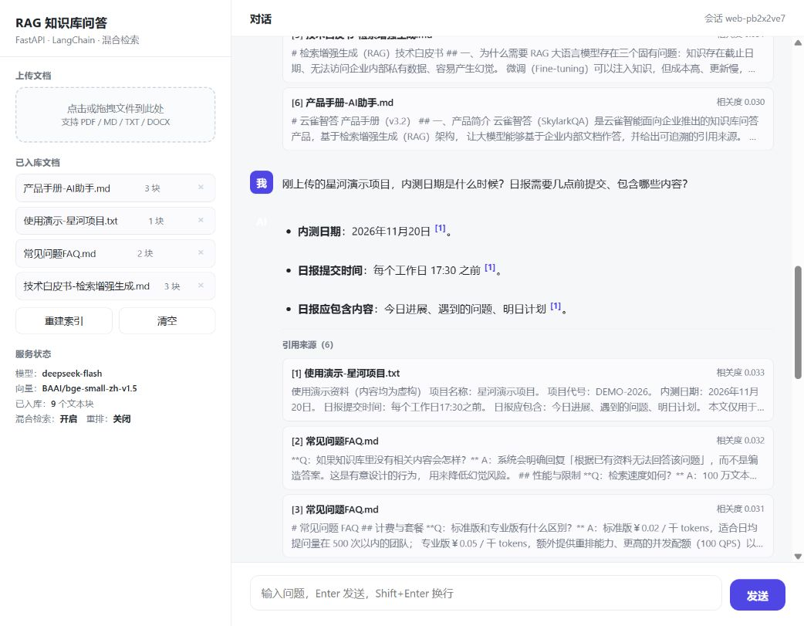
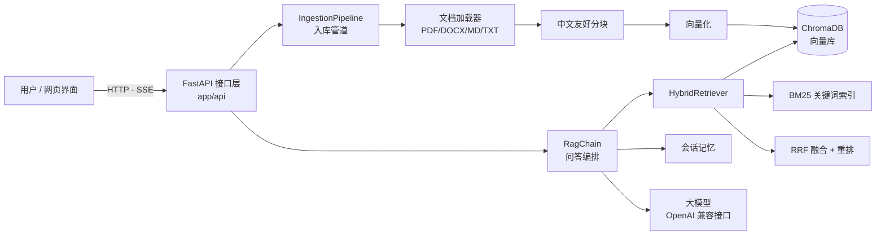

# RAG 知识库问答系统

基于 **FastAPI + LangChain** 的检索增强生成（RAG）知识库问答服务。上传企业文档后，即可针对文档内容提问，回答带引用溯源、支持流式输出与多轮对话。


## 运行演示



上图为此前本地运行的演示记录，展示资料上传、带编号的回答及原文引用。
`data/samples` 为虚构业务资料，其中价格、性能、召回率等描述仅作问答素材，**不代表本项目实测结果**。项目实测数据见下方检索评估。

---

## 目录

- [功能特性](#功能特性)
- [系统架构](#系统架构)
- [快速开始](#快速开始)
- [配置说明](#配置说明)
- [API 接口](#api-接口)
- [项目结构](#项目结构)
- [关键设计决策](#关键设计决策)
- [效果评估](#效果评估)
- [测试](#测试)
- [Docker 部署](#docker-部署)
- [后续可扩展方向](#后续可扩展方向)

---

## 功能特性

| 能力 | 说明 |
| --- | --- |
| 多格式文档入库 | PDF / DOCX / Markdown / TXT，PDF 按页保留页码 |
| 中文友好分块 | 优先在段落与中文句末标点处切分，相邻块保留重叠 |
| **混合检索** | 向量语义检索 + BM25 关键词检索，用 RRF 融合，兼顾语义与专有名词 |
| 可选重排 | 内置轻量重排器，可一行替换为 bge-reranker 等交叉编码器 |
| 引用溯源 | 回答标注 `[1][2]`，返回来源文件、页码、相关度与原文片段 |
| 流式输出 | 基于 SSE 逐 token 推送，首字节延迟低 |
| 多轮对话 | 按 `session_id` 维护上下文，可独立清空 |
| 拒答保护 | 检索不到资料时明确回复「无法回答」，降低幻觉 |
| 在线管理 | 网页端上传 / 列表 / 删除 / 重建索引，无需重启服务 |
| 模型无关 | 任意 OpenAI 兼容接口（DeepSeek / 通义 / 智谱 / OpenAI），改配置即可切换 |
| 本地向量化 | 使用本地 `bge-small-zh-v1.5` 生成向量；DeepSeek 回答仍需联网 |

---

## 系统架构



**请求链路（问答）**

```
问题 → 混合检索(向量+BM25) → RRF 融合 → [可选]重排 → 拼装带编号的上下文
    → 携带历史消息调用大模型 → 流式返回答案 + 引用来源
```

---

## 快速开始

### 1. 安装依赖

Windows 安装 Python 3.11 后，可在 PowerShell 运行 `./setup.ps1` 自动创建环境、安装依赖并生成 `.env`；填写密钥后运行 `./start.ps1`。启动脚本会检查配置，再加载模型。若 PowerShell 阻止脚本执行，可使用下面逐条命令，不必修改系统执行策略。

建议使用 **Python 3.11**。以下为 Windows PowerShell 操作，在项目根目录执行；无需先激活虚拟环境。

```powershell
py -3.11 -m venv .venv311
.\.venv311\Scripts\python.exe -m pip install -r requirements-local.lock.txt
Copy-Item .env.example .env
```

`requirements-local.lock.txt` 保存 Windows / Python 3.11 的运行依赖版本。其他平台可安装 `requirements-local.txt`，需自行验证兼容性。

### 2. 配置模型

编辑 `.env`，填写自己的 API Key：

```dotenv
OPENAI_API_KEY=请填写自己的密钥
OPENAI_BASE_URL=https://api.deepseek.com/v1
LLM_MODEL=deepseek-flash
EMBEDDING_PROVIDER=local
EMBEDDING_MODEL=BAAI/bge-small-zh-v1.5
LOCAL_EMBEDDING_MODEL=BAAI/bge-small-zh-v1.5
```

对话模型名称以账号实际可用模型为准。首次使用本地 BGE 模型需要联网下载，之后可以复用缓存；也可将 `LOCAL_EMBEDDING_MODEL` 设置为本机模型目录。DeepSeek 负责生成回答，BGE 负责文档向量化。

### 3. 启动并体验

```powershell
.\.venv311\Scripts\python.exe -m app.main
```

打开 <http://localhost:8000>，上传 `data/samples` 中的示例文档，等待入库完成后提问：

1. “私有化部署的起步价格是多少？”——检查答案及引用原文。
2. “如果需要 4 个实例，一年多少钱？”——观察同一会话中的连续问答。
3. 提问资料未包含的问题——检查是否明确说明依据不足。

也可运行 `start.ps1` 启动。接口文档位于 <http://localhost:8000/docs>。
命令行批量导入示例资料：

```powershell
.\.venv311\Scripts\python.exe -m scripts.ingest data/samples
```

PyCharm 的项目解释器请选择 `.venv311/Scripts/python.exe`。切换向量模型后，需要重建知识库，避免混用不同模型生成的向量。

仓库不包含真实密钥、虚拟环境、模型缓存和历史知识库。请只提交 `.env.example`，把自己的密钥留在本地 `.env`。

---

## 配置说明

所有配置通过环境变量或 `.env` 覆盖，字段定义见 `app/config.py`。

| 变量 | 默认值 | 说明 |
| --- | --- | --- |
| `OPENAI_API_KEY` | — | 大模型 / 向量模型密钥 |
| `OPENAI_BASE_URL` | `https://api.deepseek.com/v1` | OpenAI 兼容接口地址 |
| `LLM_MODEL` | `deepseek-chat` | 对话模型 |
| `EMBEDDING_PROVIDER` | `openai` | `openai` 远程 / `local` 本地 |
| `EMBEDDING_MODEL` | `text-embedding-3-small` | 向量模型 |
| `CHUNK_SIZE` / `CHUNK_OVERLAP` | `700` / `120` | 分块大小与重叠字符数 |
| `TOP_K` | `6` | 送入大模型的上下文条数 |
| `VECTOR_TOP_K` / `BM25_TOP_K` | `20` / `20` | 两路检索各自的候选池 |
| `ENABLE_HYBRID` | `true` | 是否开启混合检索 |
| `ENABLE_RERANK` | `false` | 是否开启重排 |
| `RRF_K` | `60` | RRF 平滑常数 |
| `MAX_HISTORY_TURNS` | `6` | 多轮对话携带的历史轮数 |
| `MAX_UPLOAD_MB` | `32` | 单文件上传上限 |

---

## API 接口

启动后访问 `/docs` 可查看交互式文档。

| 方法 | 路径 | 说明 |
| --- | --- | --- |
| `POST` | `/api/chat` | 问答（非流式） |
| `POST` | `/api/chat/stream` | 问答（SSE 流式） |
| `DELETE` | `/api/chat/session/{session_id}` | 清空指定会话上下文 |
| `POST` | `/api/documents/upload` | 上传文档并入库 |
| `GET` | `/api/documents` | 查看已入库文档与文本块数量 |
| `DELETE` | `/api/documents/{source}` | 删除指定文档 |
| `POST` | `/api/documents/reindex` | 重新扫描上传目录并重建索引 |
| `DELETE` | `/api/documents` | 清空整个知识库 |
| `GET` | `/health` | 健康检查与服务状态 |

**调用示例**

```bash
curl -X POST http://localhost:8000/api/chat \
  -H "Content-Type: application/json" \
  -d '{"question": "私有化部署多少钱？", "session_id": "demo"}'
```

```json
{
  "answer": "私有化部署按年授权，起步价 ￥18 万 / 年，包含 3 个实例 [1][2]。",
  "citations": [
    {
      "index": 1,
      "source": "产品手册-AI助手.md",
      "page": null,
      "score": 0.8123,
      "snippet": "私有化版：部署在客户内网，数据不出域，按年授权，起步价 ￥18 万 / 年…"
    }
  ],
  "session_id": "demo",
  "used_context": true
}
```

---

## 项目结构

```
rag-knowledge-base/
├── app/
│   ├── main.py                 # FastAPI 入口、路由挂载、健康检查
│   ├── config.py               # pydantic-settings 集中配置
│   ├── container.py            # 依赖容器（单例装配）
│   ├── api/
│   │   ├── routes_chat.py      # 问答接口（含 SSE 流式）
│   │   ├── routes_documents.py # 文档管理接口
│   │   └── schemas.py          # 请求 / 响应模型
│   ├── core/
│   │   ├── embeddings.py       # 向量模型工厂（远程 / 本地）
│   │   ├── llm.py              # 大模型工厂
│   │   ├── vectorstore.py      # ChromaDB 封装
│   │   ├── retriever.py        # 混合检索 + RRF + 重排
│   │   ├── rag_chain.py        # 问答编排与引用溯源
│   │   └── memory.py           # 会话记忆
│   ├── ingestion/
│   │   ├── loader.py           # 多格式加载器
│   │   ├── splitter.py         # 中文友好分块
│   │   └── pipeline.py         # 入库流程编排
│   └── utils/logging.py
├── web/index.html              # 单文件网页界面
├── scripts/
│   ├── ingest.py               # 命令行入库工具
│   └── evaluate.py             # 检索质量评估
├── tests/                      # pytest 用例（全程离线，无需 API Key）
├── data/
│   ├── samples/                # 示例文档
│   └── eval_set.example.json   # 评估数据集示例
├── Dockerfile · docker-compose.yml · Makefile
└── requirements.txt · pyproject.toml
```

---

## 关键设计决策

以下说明核心实现与取舍，可结合代码和实验结果进行讨论。

**1. 为什么用混合检索而不是纯向量检索？**
纯向量检索依赖语义表示，对「产品型号、编号、专有名词」这类查询很容易漏召回，因为它们在语义空间里区分度不足。BM25 基于词频统计，恰好弥补这个短板。本项目用 RRF 融合两路结果。实际收益需要在同一数据集上通过 `--no-hybrid` 对照实验验证，本次小样本对照中两种方式命中率相同，具体结果与限制见评估报告。

**2. 为什么用 RRF 融合，而不是加权分数？**
两路检索的分数定义和尺度不同（向量检索分数取决于距离度量，BM25 使用词频统计），直接加权需要先做归一化，而归一化方式本身又引入了主观选择。RRF 只用「排名」信息：

```
score(d) = Σ 1 / (k + rank_i(d))
```

天然无需归一化，鲁棒性好，实现只有几行代码。

**3. 分块大小为什么是 700 / 120？**
块太小上下文不完整，块太大引入噪声并稀释关键信息。500~800 字符是实践中较稳妥的区间，重叠约 15% 可以缓解「答案恰好被切在块边界」的问题。这个参数可通过评估脚本扫参确定，而不是拍脑袋。

**4. 如何降低幻觉？**
两层防护：一是提示词明确约束「只能依据资料作答，无答案必须拒答」；二是检索为空时直接返回固定话术，根本不给模型发挥空间。同时用 `[n]` 引用编号强制模型标注来源，用户可核验。

**5. 为什么显式写检索和生成，而不用 `RetrievalQA` 一行搞定？**
真实业务里检索与生成经常需要分别调参、分别埋点、分别替换实现（比如把向量库换成 Qdrant，或把重排换成交叉编码器）。显式编排让每个环节都可观测、可替换，这是工程可控性的取舍。

**6. 幂等入库怎么做的？**
`chunk_id = doc_id + 序号`，其中 `doc_id` 是文件内容哈希。重新入库时先用 `source` 删除旧块再写入，因此同一文件反复入库不会产生重复数据。

---

## 效果评估

项目提供检索评估脚本，使用数据集中的预期来源和关键词作为参考标签。新增业务数据时，需要自行准备这些标签。先导入示例文档，再运行：

```bash
python -m scripts.evaluate --dataset data/eval_set.example.json --details
```

脚本输出 Hit@k、MRR、关键词召回率和检索耗时。结果取决于模型、资料、分块参数及硬件；本次示例集结果见 [评估报告](docs/evaluation/README.md)，原始逐题结果也已提交。

指标含义：`Hit@k` 衡量「找没找到」，`MRR` 衡量「排得准不准」，关键词召回率衡量「内容对不对」。

做对比实验：

```bash
python -m scripts.evaluate --dataset data/eval_set.example.json            # 混合检索
python -m scripts.evaluate --dataset data/eval_set.example.json --no-hybrid # 仅向量检索
```

---

## 测试

已配置 GitHub Actions：推送或提交 Pull Request 时执行离线测试与 Ruff 检查，不需要配置 API 密钥。本机已通过 37 项测试；线上 CI 状态以 GitHub 实际运行结果为准。

全部用例离线运行，不需要 API Key，也不需要联网（使用确定性的假向量模型）。

```bash
python -m pip install -r requirements-dev.txt
pytest              # 运行全部
pytest -v           # 查看每条用例
ruff check app tests scripts   # 静态检查
```

覆盖范围：分块逻辑、分词、RRF 融合、向量库读写与元数据清洗、入库管道幂等性、
文件名安全清洗、API 参数校验与状态码。

---

## Docker 部署

仓库提供 Dockerfile 和 Compose 配置，默认镜像只安装 `requirements.txt`。
如果使用本地 BGE 模型，需要调整镜像安装 `requirements-local.txt` 并准备模型缓存；也可配置同时支持对话和向量接口的远程服务。本文主要验证方式为 Windows / Python 3.11 本地启动，容器部署需另行验证。

```bash
cp .env.example .env
# 按所选模型方案填写配置、调整依赖后构建
docker compose up -d --build
```

`data/` 目录挂载到宿主机，用于保留知识库数据。

---

## 后续可扩展方向

可继续迭代的方向：

1. **查询改写（Query Rewriting）**：用大模型把口语化问题改写成检索友好的表达，通常能提升明显。
2. **接入真正的 Rerank 模型**：把 `HybridRetriever._lexical_rerank` 换成 `bge-reranker-base`，替换点已隔离在一个方法内。
3. **父文档检索（Parent Document Retriever）**：小块用于检索、大块用于生成，兼顾精度与完整性。
4. **流式接口异步化**：把 `rag_chain.stream` 改为 async，进一步降低并发下的线程占用。
5. **可观测性**：接入 LangSmith / OpenTelemetry，记录每次检索与生成的耗时与 token 消耗。
6. **权限隔离**：为文档打上部门标签，检索时按用户权限过滤（`where` 参数已预留）。

---

## 故障排查与复现边界

- 浏览器提示无法访问：先运行项目，等待控制台显示 `Application startup complete`，再打开 `http://127.0.0.1:8000`；仅上传 GitHub 不会产生在线服务。
- 首次启动较慢：本地模型需要下载、加载。网络无法访问模型仓库时，可预先下载 BGE 模型并配置其本地目录。
- 模型认证、额度或连接失败：页面会显示对应提示，请检查本地配置，勿把密钥发到公开 Issue。
- 当前验证环境为 Windows / Python 3.11，运行环境和模型下载不随仓库分发。全新环境安装验证记录见评估报告；不同系统仍需单独验证。
- 面试讨论可围绕混合检索融合、分块边界、幂等入库、SSE 错误处理和小样本评估的局限展开。介绍个人贡献时应据实描述，并说明使用了哪些现成库及辅助工具。
